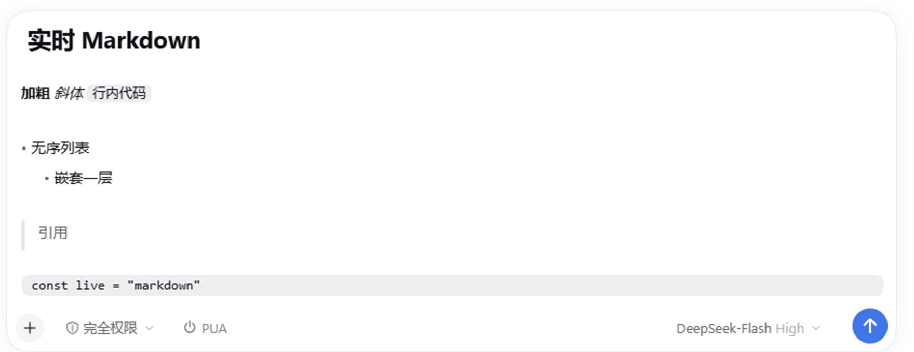

# dsh-markdown-live

> 让 [DSH](https://github.com/deepseek-ai) 桌面端的**输入框实时渲染 Markdown**，并让**已发送的用户消息按 Markdown 显示**。
>
> Live Markdown rendering inside the DSH composer, plus Markdown-rendered user messages.



## 特性

- **输入框实时渲染**：打字/粘贴 Markdown 时语法立刻以真实样式呈现，无需发送。
- **语法标记自动淡出**：光标所在行保留淡显标记方便定位，其余行的 `#`、`*`、`~~`、`` ` ``、`[]()`、`- `、`>` 自动隐去，接近所见即所得。
- **块级样式**：`#`~`######` 标题、`>` 引用、无序/有序/任务列表（含缩进层级）、代码围栏（含语言名、围栏行自动收起）、`---` 分割线。
- **交互增强**：列表/引用 `Shift+Enter` 自动延续；`Backspace` 移除标记、退出空代码行；代码围栏自动补全；多行粘贴到列表/引用自动补前缀。
- **中文输入友好**：拼音组合阶段文字保持正常颜色；标记与正文的分隔空格是普通文本节点，光标停在其中。
- **发送内容不变**：所有渲染只作用于显示层（Lexical 文本格式位 + DOM class），提交文本仍是逐字节不变的 Markdown。
- **用户消息渲染**：覆盖宿主 `text` 渲染器，复用 DSH 自带 Markdown 渲染器；@ 提及 / 技能 chip / 消息操作按钮全部保留，普通换行也会保留。
- **无构建步骤**：全部逻辑在 `client.js` 单文件里，改完宿主热重载即可生效。

## 环境要求

- DSH 桌面版 **0.2.x**（web 平台的 client bundle）。
- 已启用 `@deepseek-ai/dsh-client-locale`、`@deepseek-ai/dsh-client-ui-conversation` 两个 client 插件（DSH 自带）。

## 安装

本仓库本身就是插件目录（bundle package：`package.json` + `cordis.patch.yml` + `index.js` + `client.js`）。

1. 克隆仓库：

   ```bash
   git clone https://github.com/9426Haruka/dsh-markdown-live.git
   ```

2. 在 DSH 里安装该目录作为 bundle：
   - 打开 **设置 → 插件**，使用「安装插件 / 从本地安装」并选择克隆下来的目录；或
   - 调用 agent 的 `plugin_manager` 工具安装：
     `plugin_manager install_bundle(target = "<克隆目录的绝对路径>")`。

3. 插件会出现在 **设置 → 插件** 列表里（显示名 `dsh-markdown-live`），可随时开关。重载客户端后生效。

> 卸载：在 设置 → 插件 中禁用/移除；本插件不修改 profile 之外的文件。

## 自定义样式

插件所有颜色都走 CSS 变量，可以在 DSH 的自定义样式里覆盖，例如：

```css
[data-composer-input] {
  --dml-code-bg: #eceef0;        /* 行内代码背景 */
  --dml-code-block-bg: #eceef0;  /* 代码块背景 */
  --dml-mark-ink: rgba(127, 127, 127, 0.55); /* 语法标记颜色 */
}
```

## 支持的语法

- 行内：`**粗体**`、`__粗体__`、`*斜体*`、`_斜体_`、`~~删除线~~`、`` `行内代码` ``、`[文本](url)`、``（按链接样式，不加载图片）
- 块级：`#`~`######` 标题（要求 `#` 后有空格和内容）、`>` 引用、`-`/`*`/`+` 无序列表、`1.`/`1)` 有序列表、`- [ ]`/`- [x]` 任务列表、` ``` ` / `~~~` 代码围栏（含语言标记）、`---` 分割线
- 围栏内的内容不做行内解析（保持字面）；光标不在围栏行时围栏标记收起，代码块显示为连续圆角块。

## 实现概要

| 面 | 做法 |
| --- | --- |
| 输入框 | 通过 `[data-composer-input].__lexicalEditor` 接管 Lexical 编辑器：读取 root 下的段落/文本节点 → 把软换行（`Shift+Enter` 的 linebreak 节点、粘贴进来的字面 `\n`）归一化成段落（文本投影不变，DSH 的 `$composerLayout` 以单个 `\n` 连接段落）→ 按行分类块级角色、扫描行内语法 → 在 `editor.update()` 里切分文本节点、给正文写 Lexical 的 bold/italic/strikethrough/code 格式位、给标记字符打 `unmergeable` → 在提交后的 DOM 上打 class 实现块级样式与标记淡出。 |
| 用户消息 | 覆盖 `conversation.user.text.node` 的 `text` 单元格（priority -1 阴影掉宿主 priority 100 的纯文本渲染器），用宿主 `@deepseek-ai/dsh-client-ui-primitives` 的 `MarkdownText` 渲染 `raw`；`file/folder/skill/session/command/secret` 等节点仍走宿主原渲染器。 |
| 性能 | 逐块分析缓存 + 块级局部重绘 + 每帧合并一次；草稿超过 12000 字符时暂停实时渲染，保证输入流畅。 |
| 清理 | 插件禁用/卸载时移除样式表、监听器、DOM class，并尽力清除写入的格式位。 |

关键官方接口：`conversation.user.text.node`（keyed，最低 priority 胜出）、`ctx.slots.register`、`ctx.locale.register`、Lexical 的 `editor.update / TextNode.splitText / setFormat / setDetail`。

## 已知限制

- **表格未适配**：`|` 行按普通文本显示（不改变草案文本的前提下难以渲染为真表格）。
- 图片不内联加载预览，只按链接样式标出。
- 富文本粘贴会被当作纯文本，按 Markdown 语义重新着色（不保留原 HTML 样式）。
- 输入框内不做代码语法高亮（逐字着色需要大量文本节点分裂，容易卡）；已发送消息里的代码块由宿主渲染器提供高亮。
- 依赖 DSH 内部 Lexical 编辑器节点结构，DSH 大版本升级后可能需要适配。

## 文件

- `client.js` — 全部浏览器端逻辑（无构建步骤）：行内语法扫描器、块级分类、Lexical 归一化/成形/格式、DOM 呈现、用户消息渲染器、样式与本地化。
- `index.js` — Host 半：惰性载体，让插件在 设置 → 插件 中有一行可开关。
- `cordis.patch.yml` — bundle patch，插入 `markdown-live` 行。
- `locale/en.json`、`locale/zh.json` — 插件标题/描述。
- `icon.svg` — 插件图标。
- `docs/preview.png` — 截图。

## 开发

无构建步骤。改 `client.js` 后宿主会热重载 client bundle；语法检查：

```bash
node --check client.js
```

## License

[MIT](LICENSE)
